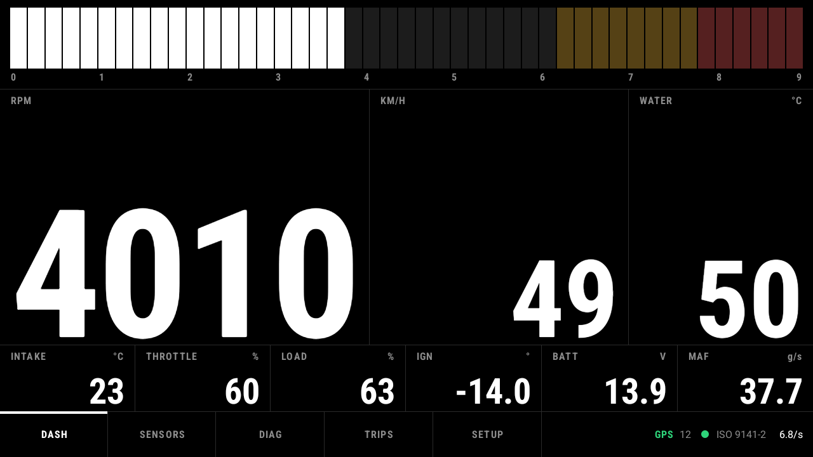
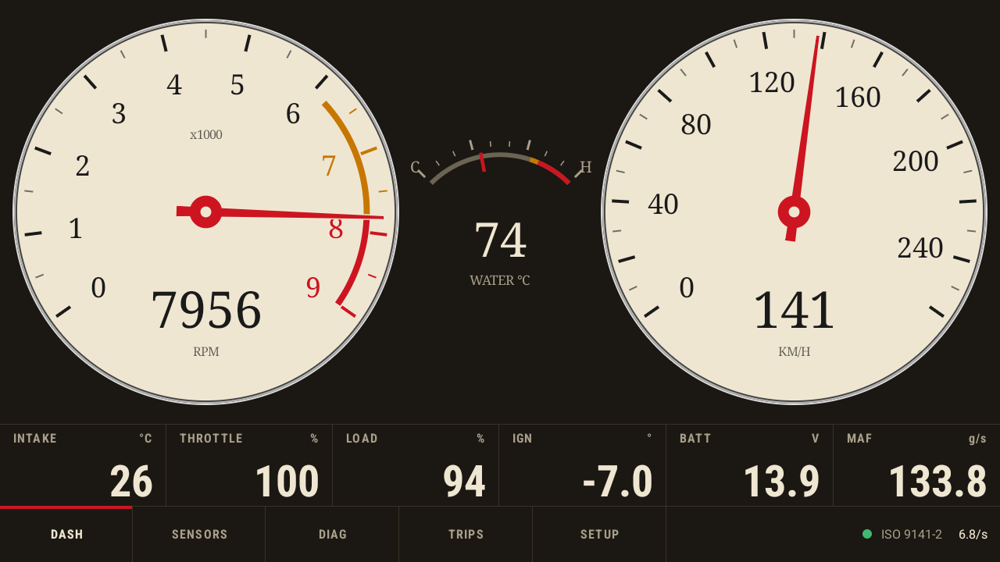
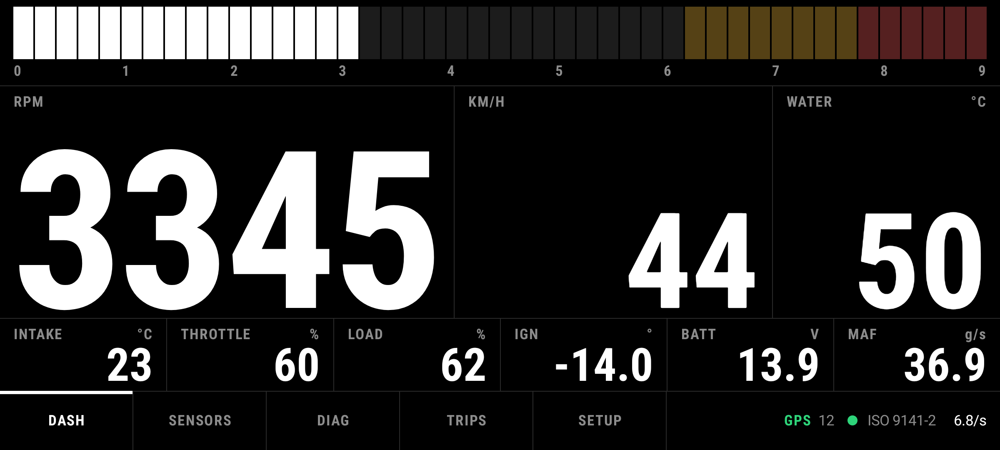
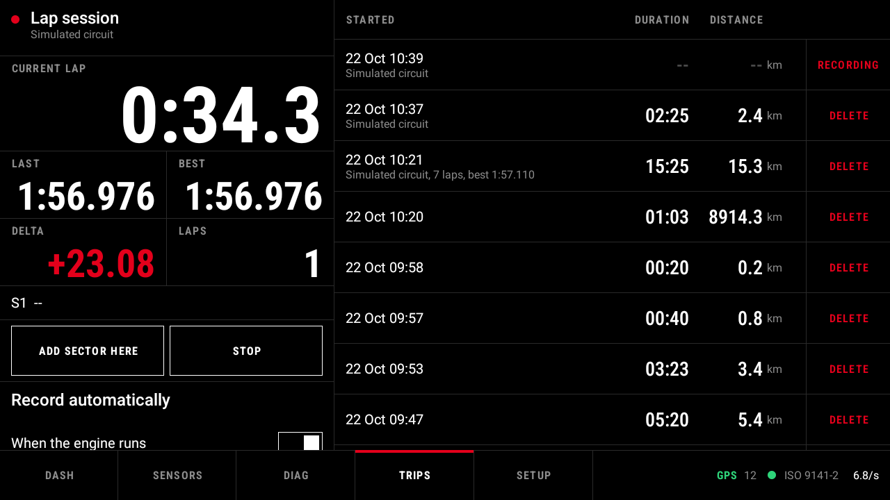
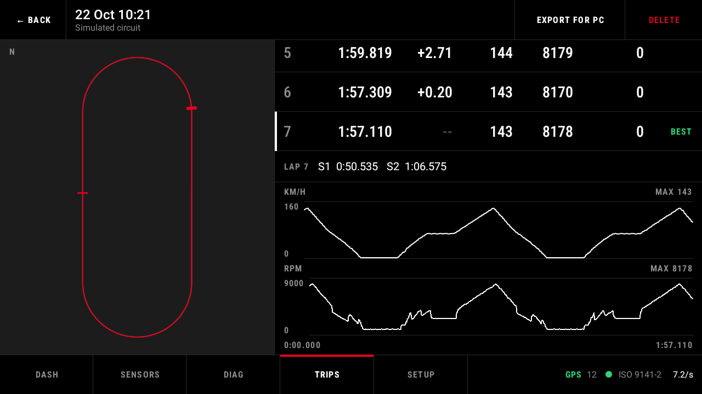

# K-Line Dash

K-Line Dash turns an Android car head unit or a phone in a car mount into a motorsport-style
dashboard for your car. Plug a cheap ELM327 Bluetooth or Wi-Fi OBD2 adapter into the car and it
shows live engine data in big, glanceable numerals, reads and clears fault codes, warns you when
the coolant runs hot or the battery drops, records every trip with GPS, and times laps on a track
day. It works fully offline: no account, no cloud, no ads, no Google Play Services.



| Dial theme ("Classic") | On a phone (914 x 411) |
|---|---|
|  |  |
| **Lap timing** | **Trip detail with laps** |
|  |  |

## Features

- **Live dashboard:** a segmented RPM bar and large numerals, or round dials, a center tach, a
  digital arc or a virtual cockpit. Swipe between pages: the main page, grids of numbers and
  60-second graphs, and a track page with peak hold and a shift light. Pages and fields are yours
  to edit.
- **Sensors:** everything your car reports, with how often each value updates.
- **Diagnostics:** stored, pending and permanent fault codes with offline descriptions (the
  standard meanings for any car, plus Toyota 2ZZ-GE notes when chosen under SETUP > Car), the
  check-engine light, readiness monitors, freeze frame and VIN. Clearing codes asks twice and
  only works with the engine off.
- **Warnings:** coolant temperature, battery voltage, a new fault code, the check-engine light and
  a lost adapter, as a coloured frame and banner on every page, with an optional tone.
- **Trips:** recorded automatically while the engine runs (or while the car moves, without an
  adapter), with GPS route, distance, speeds, max RPM and an estimated fuel use.
- **Lap timing:** set a start/finish line and sector lines while driving; current, last and best
  lap, the delta to your best, sector splits, and a lap table with speed and RPM graphs afterwards.
- **Export for PC:** VBO (Circuit Tools, RaceChrono, RaceRender), GPX (Google Earth, map apps) and
  CSV (Excel, LibreOffice). Copy to a USB stick or SD card, or download over Wi-Fi from a phone or
  laptop with a PIN.
- **Themes:** nine built-in themes (Race, Minimal, Retro, Day, Rosso, R-Spec, Autobahn, Virtual,
  Classic), automatic day/night switching, and your own themes as JSON (`docs/themes.md`).
- **Head-unit friendly:** starts with the unit, reconnects when the ignition comes back on, keeps
  the screen on, and explains how to keep FYT/UIS and Microntek units from closing the app.
- **Metric or imperial**, and every screen from a 640 x 360 phone to a 1920 x 720 head unit.
- **Simulator:** a virtual car (with a GPS circuit), so you can try everything without a car.

## What you need

| | |
|---|---|
| **Device** | Android 8.0 or newer, held or mounted in landscape: a car head unit (1024 x 600 and up), a tablet or a phone. |
| **Adapter** | An ELM327-compatible OBD2 adapter over Bluetooth Classic, Bluetooth LE or Wi-Fi. |
| **Car** | Any car with an OBD2 port: in the EU most petrol cars from 2001 and diesels from 2004, in the US from 1996. CAN and the older K-line (ISO 9141-2, KWP2000) and J1850 protocols are detected automatically. |

### Supported adapters

K-Line Dash speaks plain ELM327, so an adapter that works with generic apps such as Torque, Car
Scanner or OBD Fusion should work here too (sources: `docs/research/popular-obd-adapters.md`).

- **Works well:** OBDLink LX, MX+ and CX, Vgate vLinker MC+/BM+/FS/MS, Vgate iCar Pro 2S,
  Veepeak OBDCheck BLE+ and VP11. These are the best choice for CAN cars (2008 and later).
- **Works, with caveats:** the cheap ELM327 "v1.5" and "v2.1" clones (Konnwei KW902/KW905, Viecar,
  BAFX, Panlong, Vgate iCar2 / iCar Pro BLE). Pair a Bluetooth Classic adapter first (PIN 1234,
  0000 or 6789). The Konnwei KW905 only works over Bluetooth LE.
- **Does not work:** dongles that only talk to their own app, such as BlueDriver, ThinkDiag, Launch
  Golo/EasyDiag, TOPDON TopScan, ANCEL BD200 and Autel MaxiAP. The app tells you when it finds one.

## Install

1. Open the [latest release](https://github.com/stijnvandepol/CarPlayinfo/releases/latest) and
   download `kline-dash-<version>.apk` and `SHA256SUMS.txt`.
2. **Check the download** (optional, recommended). On a PC, in the download folder:
   - Linux: `sha256sum -c --ignore-missing SHA256SUMS.txt`; macOS:
     `shasum -a 256 -c --ignore-missing SHA256SUMS.txt` (the file also lists the crash-report
     mapping, which you do not need)
   - Windows PowerShell: `Get-FileHash kline-dash-<version>.apk -Algorithm SHA256` and compare the
     hash with the line in `SHA256SUMS.txt`.
3. **Copy the APK to the device** (USB stick, or download it there directly) and open it with a file
   manager. Android asks to allow installing apps from that source ("Install unknown apps"): allow it
   for this one install, then switch it off again.
4. **Updates** install over the previous version in the same way; your settings and trips stay.

K-Line Dash is not on Google Play. Only install APKs from the releases page of this repository.

## First run

A short setup opens on first start: choose your adapter type, connect (pair a Bluetooth Classic
adapter in the Android settings first), test the connection, and pick units, theme and automatic
trip recording. No adapter yet? Choose the simulator. You can run the setup again under
SETUP > Help.

## Privacy

K-Line Dash works offline. It has no account, no ads and no analytics, and it sends nothing
anywhere. Trips, tracks, settings and crash reports stay on the device until you export them
yourself. Location is only used for GPS speed, routes and lap times. Nothing is backed up to the
cloud. Details, and the limits of the Wi-Fi export: [`docs/SECURITY.md`](docs/SECURITY.md).

## Help and troubleshooting

The app has its own help under **SETUP > Help**: getting connected, troubleshooting (adapter not in
the list, connected but no data, "Adapter not supported", slow values on older cars, a head unit
that closes the app, no GPS fix, a trip that did not record), supported adapters, lap timing,
exporting to a PC and your car battery. **SETUP > Debug** shows what the adapter and the car say,
which helps when you report a problem.

Found a bug? [Open an issue](https://github.com/stijnvandepol/CarPlayinfo/issues) with the app
version (SETUP > About) and, if the app crashed, the exported crash log from SETUP > About.
Security problems: see [`docs/SECURITY.md`](docs/SECURITY.md).

## Building from source

Requirements: JDK 17 and the Android SDK (platform 35); Android Studio provides both.

```bash
./gradlew :app:assembleDebug        # app/build/outputs/apk/debug/app-debug.apk
./gradlew :obd-core:test :app:testDebugUnitTest :app:assembleDebug :app:assembleRelease :app:lintDebug   # the full gate
```

Two modules: `:obd-core` is pure Kotlin (ELM327 link, OBD signals and polling, diagnostics, trips,
laps, export formats, the Wi-Fi export server and a simulator) and `:app` is the Android app
(Bluetooth transports, the foreground service, Room storage and the Jetpack Compose UI).

- [`CODE GUIDELINES.md`](CODE%20GUIDELINES.md): the rules for all code, with the project specifics
- [`docs/design-system.md`](docs/design-system.md): the visual design, layouts and screen sizes
- [`docs/themes.md`](docs/themes.md): the theme file format
- [`docs/RELEASING.md`](docs/RELEASING.md): the signing key and how to cut a release
- [`docs/research/`](docs/research/): adapter behaviour, head-unit autostart, protocol notes
- [`CHANGELOG.md`](CHANGELOG.md): what changed per release

## License

K-Line Dash is released under the [MIT License](LICENSE). The app includes open-source libraries
under the Apache License 2.0; see SETUP > About.
