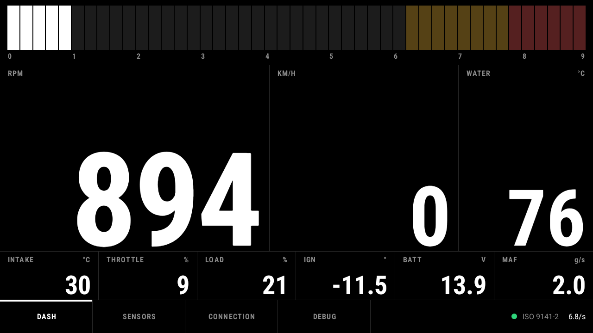

# K-Line Dash

An offline OBD2 dashboard for an Android car head unit, built for a Toyota Corolla E12 T-Sport
(2ZZ-GE, ISO 9141-2 K-line) and a cheap ELM327 adapter. No accounts, no cloud, no ads, no Google
Play Services.



## What it does

- **Live data** in the style of a motorsport display: segmented RPM bar, large numerals, the
  sensors the ECU reports as supported. Swipeable dashboard pages (main, grid with graphs, track
  page with peak hold and shift light).
- **Diagnostics:** stored, pending and permanent trouble codes with offline descriptions (generic
  SAE codes plus Toyota 2ZZ-GE notes), check-engine status, readiness monitors, freeze frame,
  VIN. Clearing codes needs two confirmations and the engine off.
- **Warnings:** coolant, battery voltage, a new trouble code while driving, the check-engine
  light, a lost adapter connection. A frame and banner on every page, optional tone.
- **Trips:** recorded to CSV automatically while the engine runs; copy to USB/SD or download over
  Wi-Fi from a phone (PIN-protected, see "Security" below).
- **Themes** as JSON (Race, Minimal, Retro, Day, plus your own), day/night switching.
- **Autostart** with the head unit and reconnection after the ignition comes back on.
- **Simulator** that behaves like the target car, so everything runs without a car.

## Hardware

| Part | Notes |
|---|---|
| Head unit | Android 12/13, landscape (1280 x 720 and up). Bluetooth Classic, BLE or Wi-Fi to the adapter. |
| Adapter | ELM327 or clone. Verified: Konnwei KW905 over BLE (service `FFF0`). Classic SPP and Wi-Fi (`192.168.0.10:35000`) are supported too. |
| Car | Any OBD2 car; tuned for K-line (ISO 9141-2 / KWP2000), where a request takes about 0.5 s. |

## Supported adapters

K-Line Dash speaks plain ELM327 text, so any adapter that works with generic apps (Torque, Car
Scanner, OBD Fusion) should work. Details and sources: `docs/research/popular-obd-adapters.md`.

- **Works well:** OBDLink LX, MX+ and CX (CX is BLE only), Vgate vLinker MC+/BM+/FS/MS, Vgate iCar
  Pro 2S, Veepeak OBDCheck BLE+ and VP11. These have STN or newer ELM327 firmware and are the best
  choice for CAN cars (2008 and later), where K-Line Dash sends several PIDs per request.
- **Works, with caveats:** the cheap ELM327 "v1.5" and "v2.1" clones (Konnwei KW902/KW905, Viecar,
  BAFX, Panlong, Vgate iCar2 / iCar Pro BLE). Some clones answer `?` to optional commands; the app
  skips those. Pair Bluetooth Classic adapters first (PIN 1234, 0000 or 6789) and press the
  adapter's button if it has one. The KW905 only works over BLE.
- **Does not work:** dongles that only talk to their own app, such as BlueDriver, ThinkDiag,
  Launch Golo/EasyDiag, TOPDON TopScan, ANCEL BD200 and Autel MaxiAP. K-Line Dash then reports
  that the adapter does not answer standard OBD commands. FIXD is unverified.

## Build

Requirements: JDK 17 and the Android SDK (platform 35). Android Studio provides both.

```bash
./gradlew :app:assembleDebug
```

The APK is `app/build/outputs/apk/debug/app-debug.apk`. Tests, lint and the full gate:

```bash
./gradlew :obd-core:test :app:testDebugUnitTest :app:assembleDebug :app:lintDebug
```

Installing on the head unit (USB stick or adb over Wi-Fi) and what to test in the car is described
per phase in `docs/fase-*-installeren-en-testen.md` (Dutch).

## Architecture

Two Gradle modules with strict layers:

- **`:obd-core`** (pure Kotlin/JVM, no Android imports, so its tests run on any JDK)
  - `transport` – the `Transport` contract (connect, write, read until the `>` prompt, close),
    Wi-Fi transport and prompt framing
  - `elm` – ELM327 parser, init and protocol detection (saved protocol first, then auto-detect,
    then explicit K-line protocols and a Toyota profile), connection manager with reconnect
  - `obd` – signal catalog (SAE J1979 formulas), supported-PID detection, the tiered poll
    scheduler
  - `diag` – trouble codes, readiness, freeze frame, vehicle info, offline code descriptions
  - `alert`, `trip`, `export` – warning rules, CSV trip log, Wi-Fi export server
  - `sim` – a K-line ELM327 simulator with fault injection
- **`:app`** (Android)
  - `transport` – Bluetooth Classic and BLE transports
  - `service` – the foreground service that owns the link, the poller, warnings, trip recording
    and export, independent of the UI
  - `data` – Room (settings, trips) with versioned migrations
  - `ui` – Jetpack Compose screens, drawn to `docs/design-system.md`

Polling only asks for what the visible page and the enabled warnings need: on K-line the whole bus
manages about two requests per second, so every extra signal slows the others.

## Documentation

- `CODE GUIDELINES.md` – rules for all code in this repository, with the project specifics
- `docs/design-system.md` – the visual design: tokens, type scale, layouts per page
- `docs/themes.md` – the theme JSON format
- `docs/research/` – ELM327 clone behaviour, head-unit autostart, the 2ZZ-GE's OBD facts, lessons
  from the earlier ESP32 prototype
- `docs/fase-*-installeren-en-testen.md` – install and in-car test plans (Dutch)

## Security

The Wi-Fi trip export is plain HTTP on the local network, an approved exception to the
guidelines' TLS rule: an offline head unit cannot present a trusted certificate. It is off by
default, started by the user, protected by a one-time PIN with lockout, read-only, and stops
itself after 10 minutes without use.
